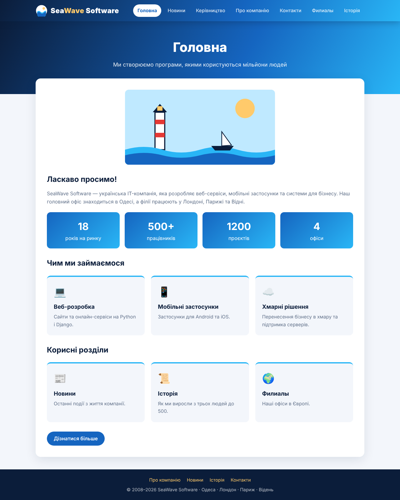
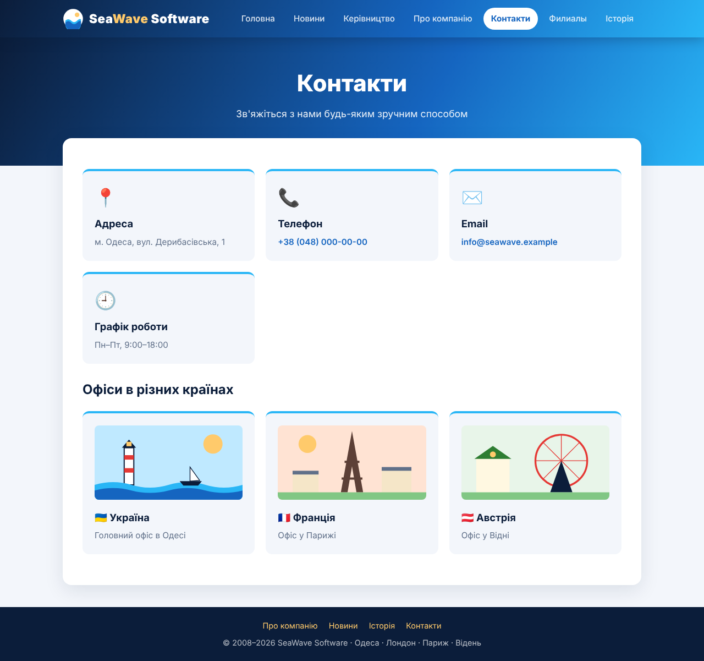
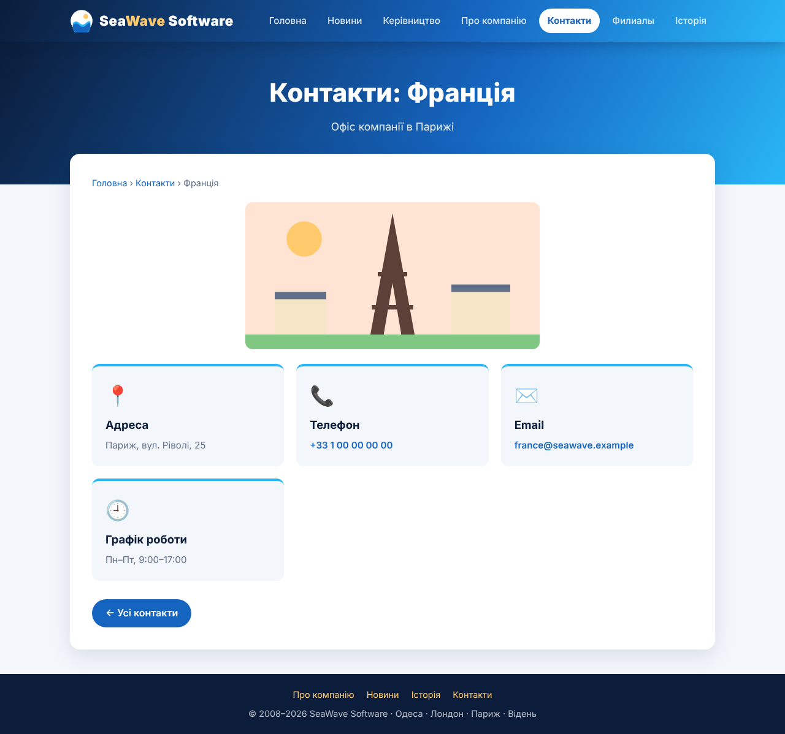
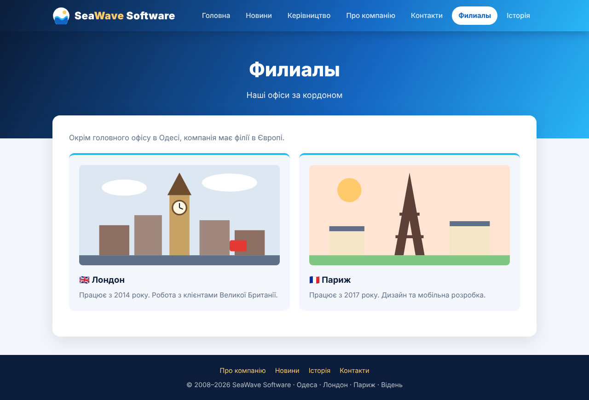
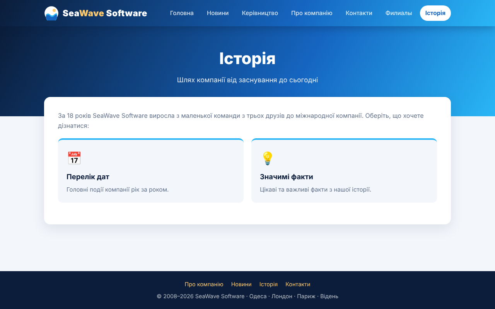
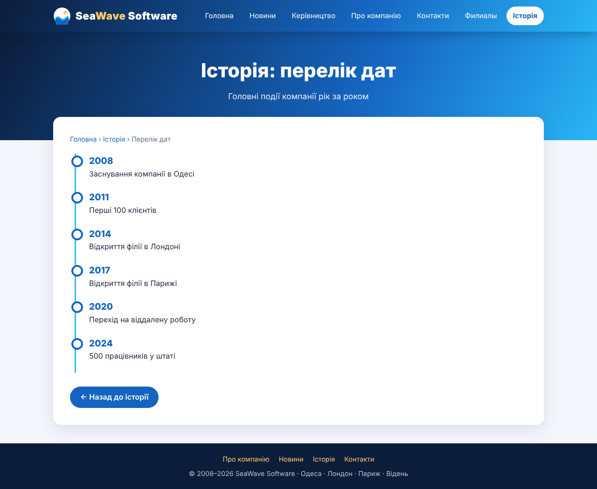
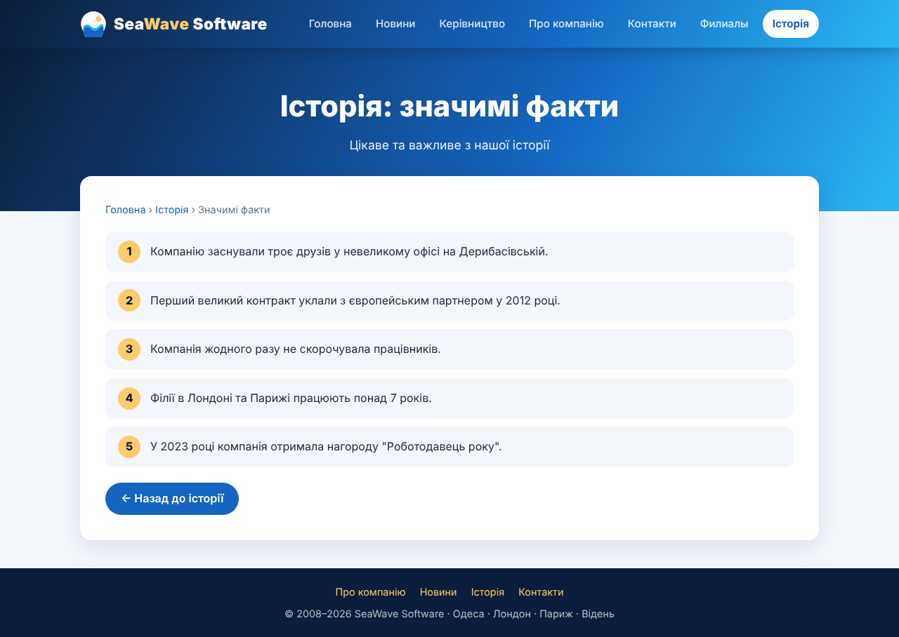
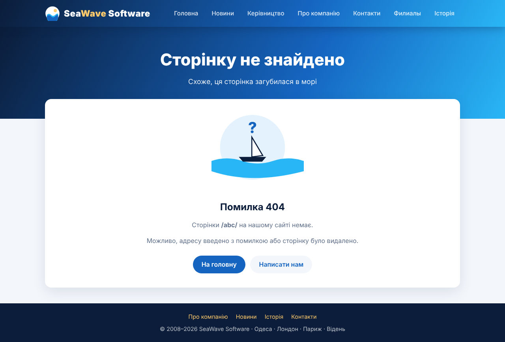

# Моя компанія — SeaWave Software

Навчальний сайт компанії на Django з вкладеними маршрутами.

## Розділи сайту

| Розділ | Адреса | Підрозділи |
|---|---|---|
| Головна | `/` | — |
| Новини | `/news/` | — |
| Керівництво | `/management/` | — |
| Про компанію | `/about/` | — |
| Контакти | `/contacts/` | `/contacts/ukraine/`, `/contacts/france/`, `/contacts/austria/` |
| Філії (додаток `branches`) | `/branches/` | `/branches/London/`, `/branches/Paris/` |
| Історія (додаток `history`) | `/history/` | `/history/dates/`, `/history/facts/` |

## Неіснуючі сторінки

- неіснуючий підрозділ відомого розділу, наприклад `/contacts/germany/`, переадресовує на сам розділ (`/contacts/`);
- будь-яка інша неіснуюча адреса, наприклад `/abc/`, показує сторінку 404.

## Запуск

```
pip install -r requirements.txt
python manage.py runserver
```

Відкрити http://127.0.0.1:8000/

## Скріншоти

| Головна | Контакти |
|---|---|
|  |  |
| **Контакти: Франція** | **Філії** |
|  |  |
| **Історія** | **Історія: дати** |
|  |  |
| **Історія: факти** | **Сторінка 404** |
|  |  |

Інші скріншоти — у папці [`screenshots/`](screenshots/).
