# Моя компанія — SeaWave Software

Навчальний сайт компанії на Django з вкладеними маршрутами.

## Розділи сайту

| Розділ | Адреса | Підрозділи |
|---|---|---|
| Головна | `/` | — |
| Новини | `/news/` | — |
| Керівництво | `/management/` | — |
| Про компанію | `/about/` | — |
| Контакти | `/contacts/` | `/contacts/ukraine/`, `/contacts/france/`, `/contacts/austria/` |
| Філії (додаток `branches`) | `/branches/` | `/branches/London/`, `/branches/Paris/` |
| Історія (додаток `history`) | `/history/` | `/history/dates/`, `/history/facts/` |

## Неіснуючі сторінки

- неіснуючий підрозділ відомого розділу, наприклад `/contacts/germany/`, переадресовує на сам розділ (`/contacts/`);
- будь-яка інша неіснуюча адреса, наприклад `/abc/`, показує сторінку 404.

## Запуск

```
pip install -r requirements.txt
python manage.py runserver
```

Відкрити http://127.0.0.1:8000/

## Скріншоти

| Головна | Контакти |
|---|---|
| 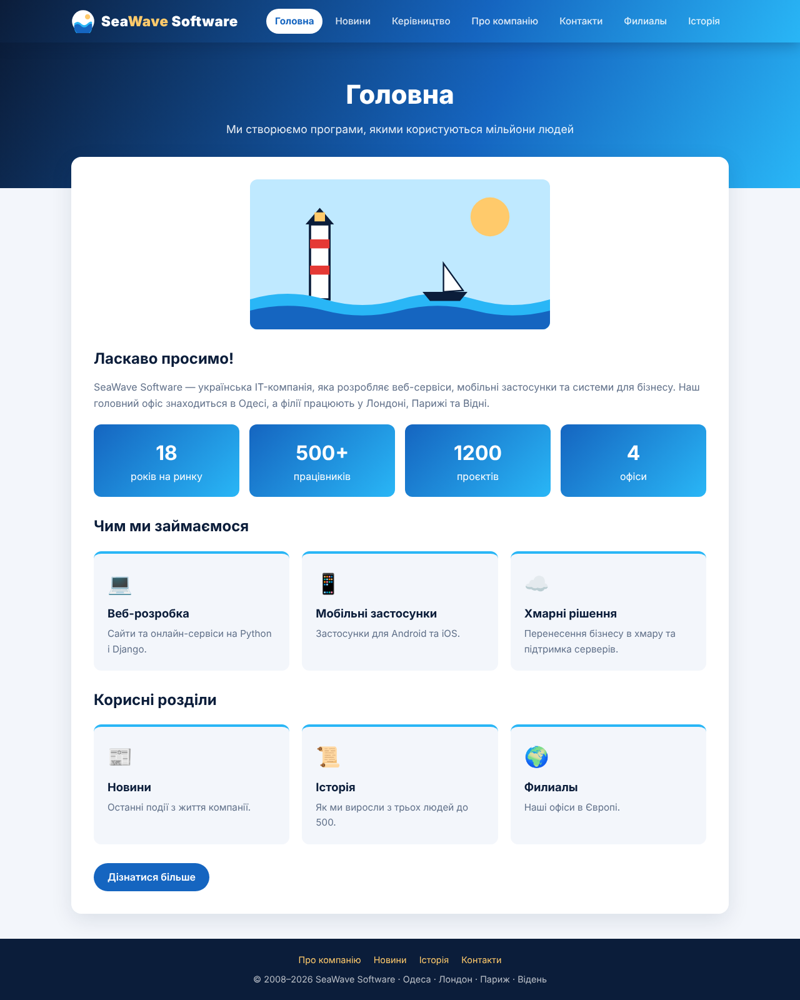 | 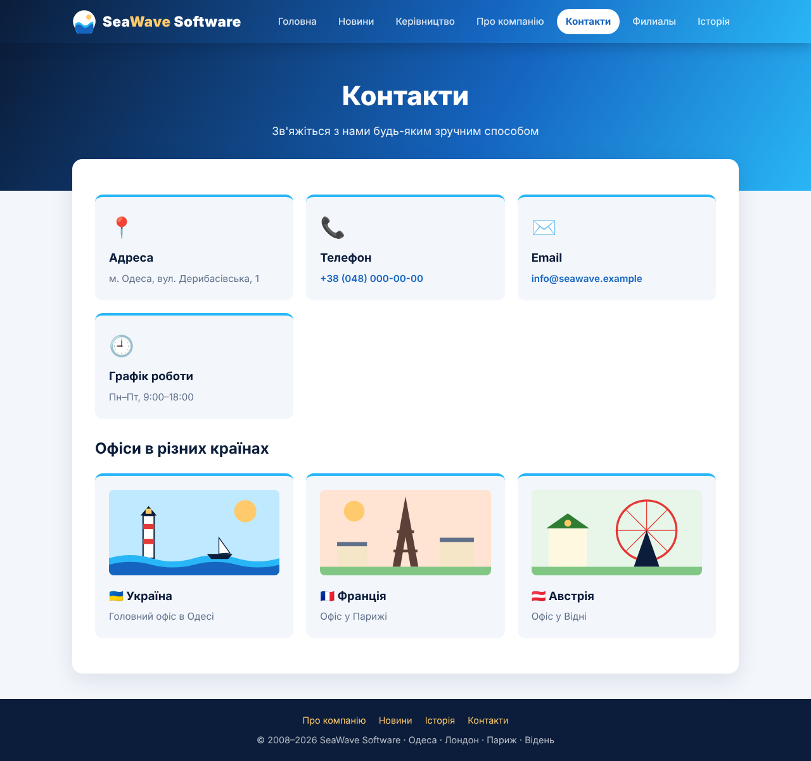 |
| **Контакти: Франція** | **Філії** |
| 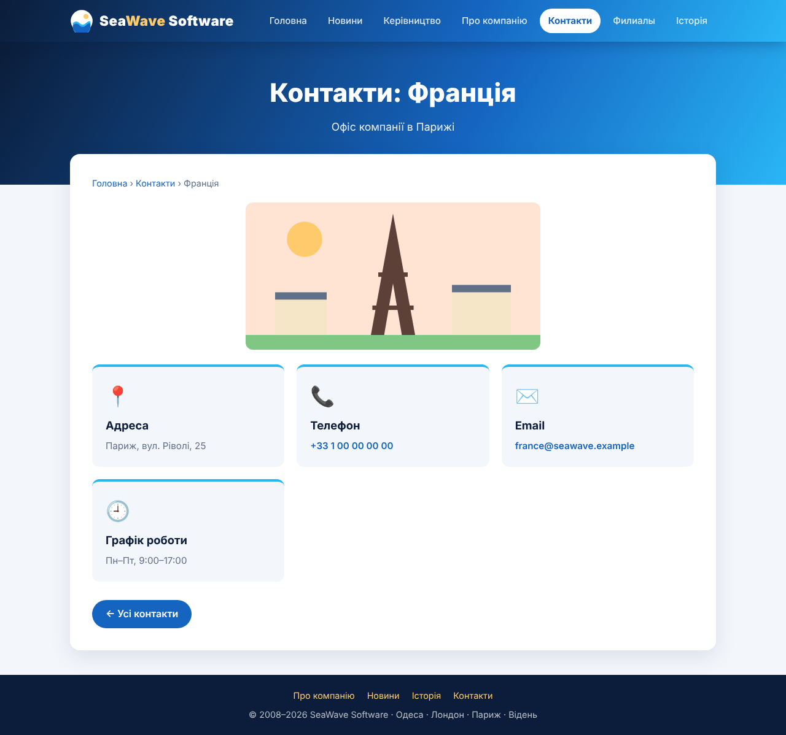 | 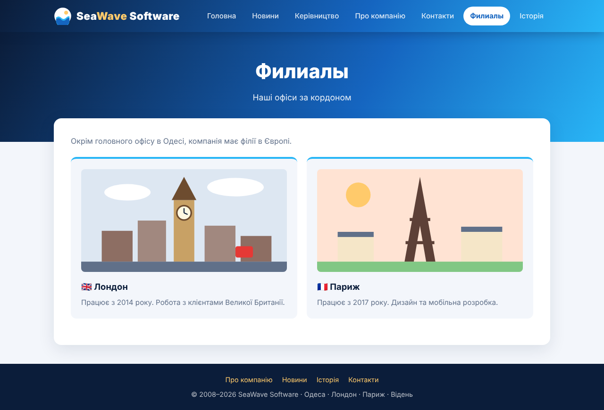 |
| **Історія** | **Історія: дати** |
| 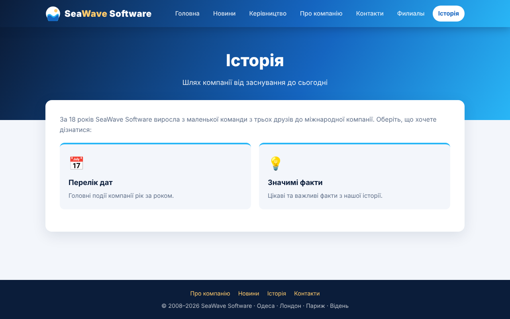 | 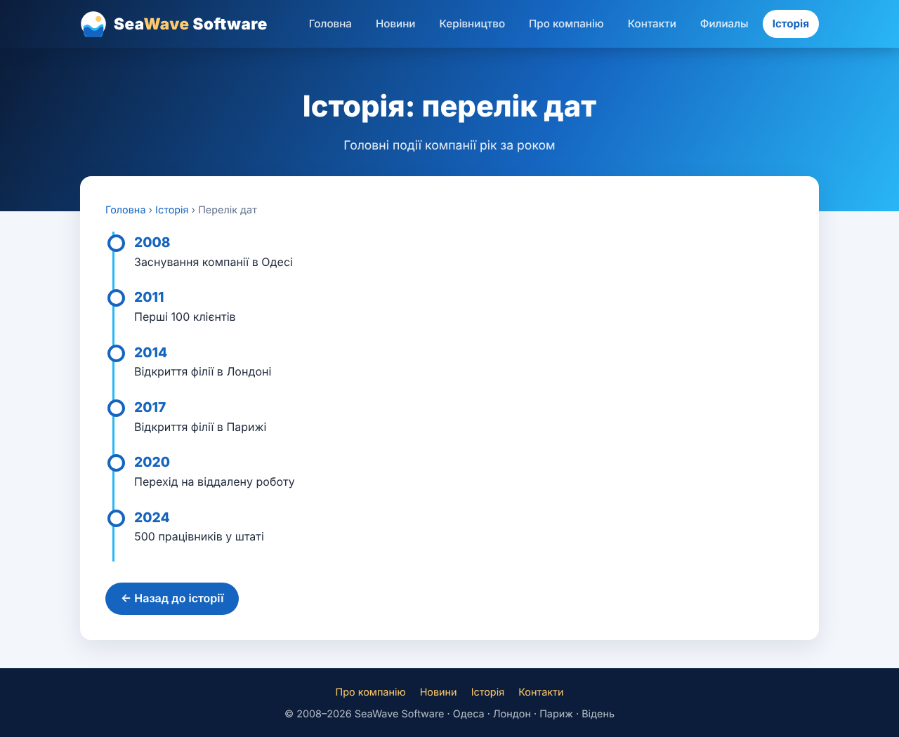 |
| **Історія: факти** | **Сторінка 404** |
| 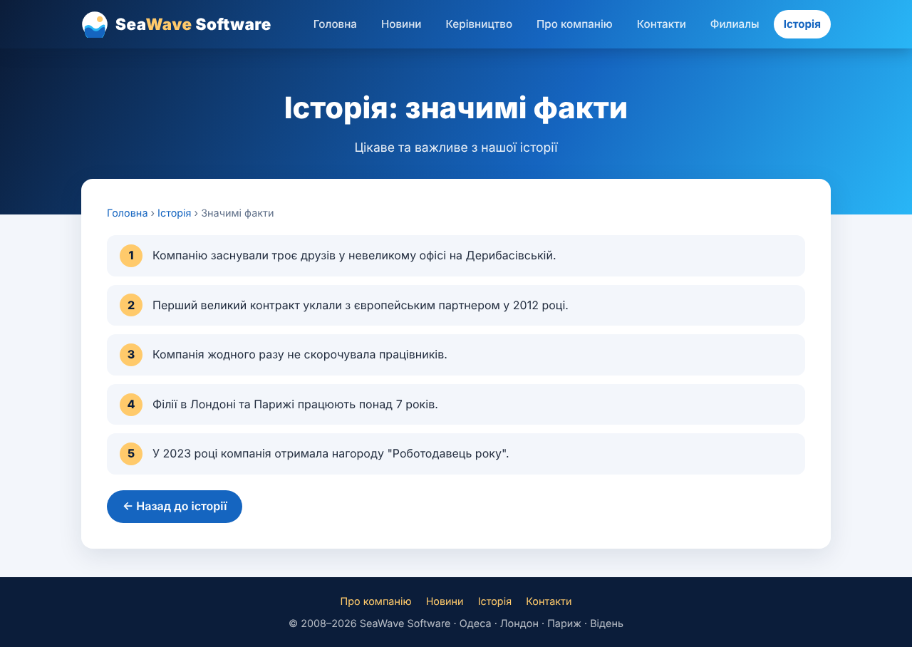 | 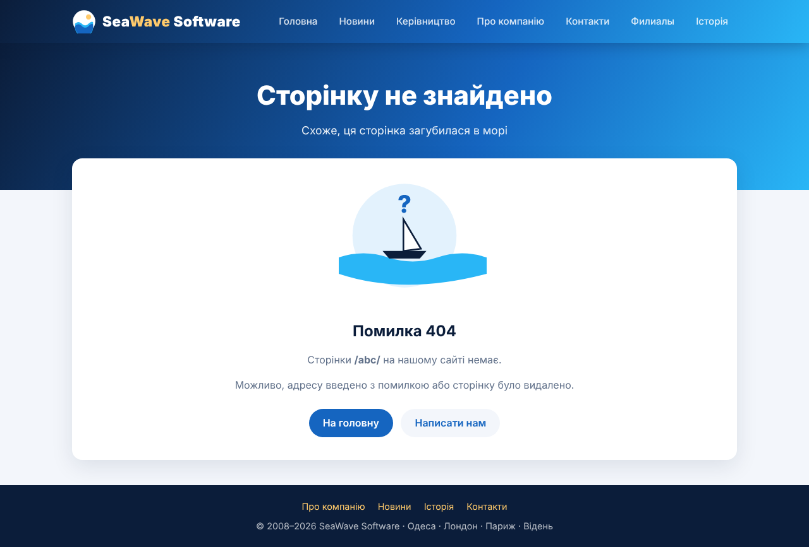 |

Інші скріншоти — у папці [`screenshots/`](screenshots/).

## ДЗ: шаблони, фільтри, наслідування

### Дані з view у вигляді складних словників
- [`core/data.py`](core/data.py) — власні класи `Employee` (керівник) і `News` (новина) та списки їхніх об'єктів.
- `management` передає словник `company`: назва, рік заснування, досвід і список об'єктів `Employee`.
- `news` передає словник `news_block`: заголовок, список об'єктів `News` і список тегів.
- `history/dates` передає список словників з роками та подіями.

### Теги в шаблонах
- `` — короткі імена для `company.employees` і `news_block.items`;
- ` … ` — картки керівників, новини, події історії;
- ` …  … ` — позначка «співзасновник», «⭐ важливо»;
- `forloop.counter` (нумерація новин) і `forloop.last` (🎉 біля останньої події).

### Стандартні фільтри
`length`, `upper`, `join`, `date:"j E Y"`, `truncatewords`, `default`.

### Власні фільтри — [`core/templatetags/my_filters.py`](core/templatetags/my_filters.py)
- `phone_format` — `380671112233` → `+38 (067) 111-22-33`;
- `initials` — «Олександр Коваленко» → «ОК» (для аватарки).

### Дані з батьківської сторінки (`base.html`)
- у `base.html` футер винесено в ``; сторінка «Контакти» бере його через `{{ block.super }}` і дописує свій рядок;
- сторінка «Про компанію» бере підзаголовок з `base.html` через `{{ block.super }}` і додає свій текст.

> Після додавання папки `templatetags` сервер треба перезапустити, інакше Django не побачить `my_filters`.

| Керівництво (`for`, `if`, `with`, свої фільтри) | Новини (`length`, `join`, `date`, `truncatewords`) |
|---|---|
| 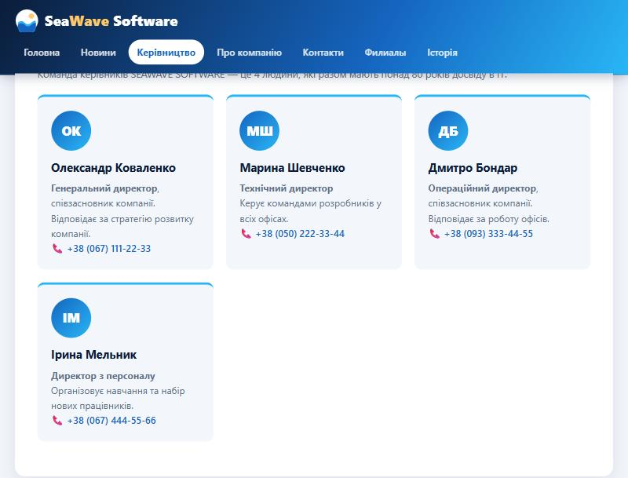 | 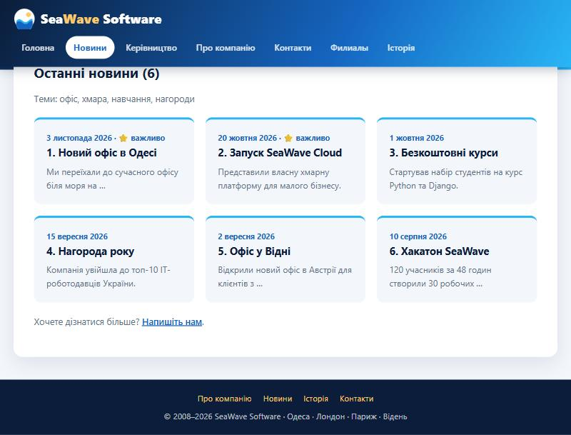 |
| **Про компанію (`block.super` у підзаголовку)** | **Контакти (`block.super` у футері)** |
| 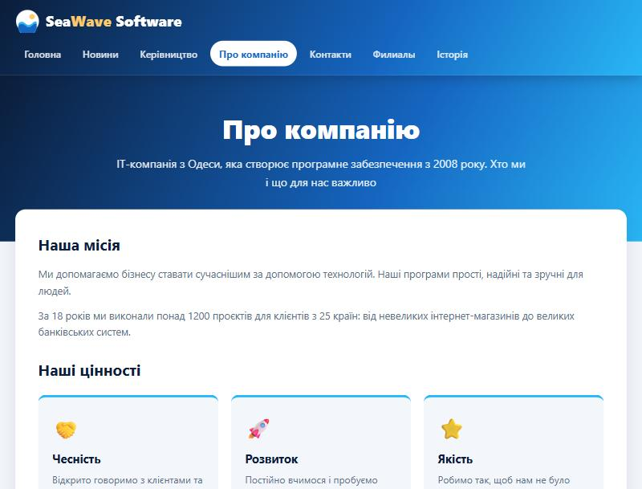 | 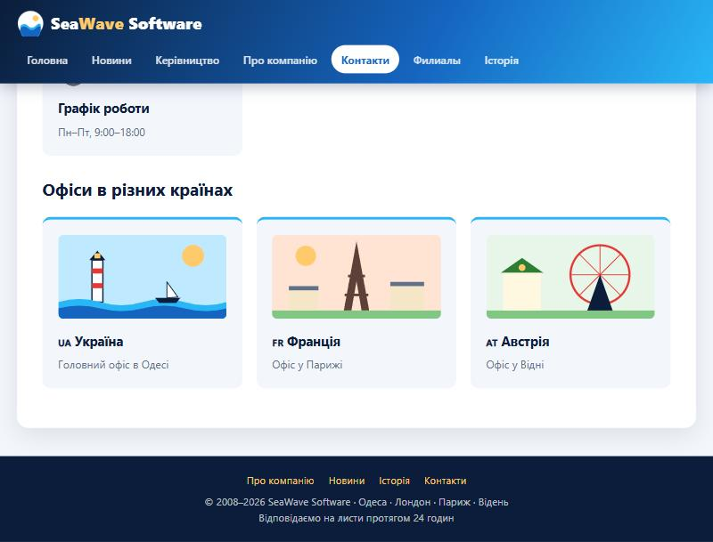 |
| **Історія: дати (`for`, `forloop.last`)** | |
| 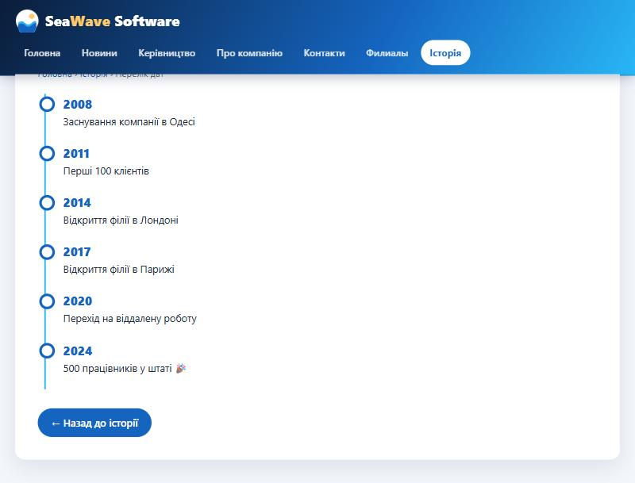 | |
